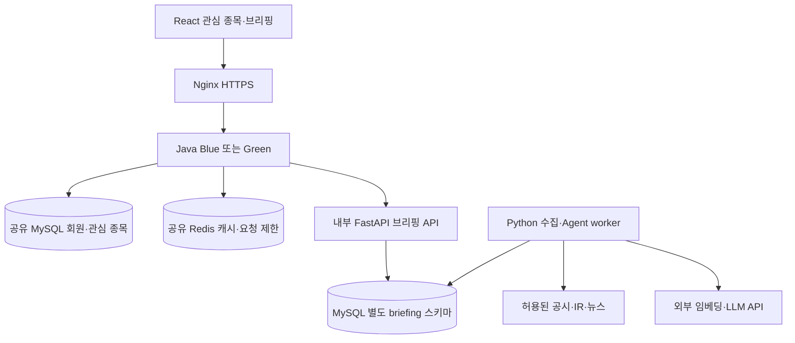

# RAG 브리핑 구조 및 화면 개편

상태: 설계 / 2026-11-16. 현재 구현 경로와 아래 새로 만들 경로를 구분한다.

## 기술 선택

- 화면: React·TypeScript, 기존 라우터 유지, TanStack Query로 서버 상태/작업 조회, Zod 응답 검증, CSS Modules와 공통 디자인 토큰. 실제 의존성 버전은 구현 PR에서 기존 package.json과 호환성을 확인해 고정한다.
- 공개 API: 기존 Spring Boot·Spring Security/JWT·MySQL·Redis. 기존 채팅 전송 방식 유지.
- AI: Python·FastAPI·Pydantic·LangGraph, 외부 LLM/임베딩 공급자 어댑터, 서버 측 문서 파서. 모델 선택은 한국어 요약·인용 정확도·지연·비용 평가로 고정하며 최신이라는 이유만으로 고르지 않는다.
- 운영: React는 기존 Vercel, Java/Python은 AWS EC2 Docker 내부망, Nginx TLS, GitHub Actions의 승인된 배포 경로. Java Blue/Green 전환은 이번 기능과 함께 회귀 검증한다.

## 서비스와 저장 책임

- Java: JWT, 회원/관심 목록, 채팅, 외부 API 진입점, 생성 요청 권한·한도. Blue/Green은 같은 MySQL·Redis를 사용한다. Python으로 이메일·JWT·전체 포트폴리오를 넘기지 않는다.
- Python: 새 FastAPI 조회 서비스와 별도 worker. 원문 수집·검색·판단·출처 검증. 기존 연구 배치를 API 요청 경로로 사용하지 않는다. 내부 포트만 사용하고 서비스 인증을 적용한다.
- 첫 주 저장: 기존 MySQL 인스턴스 안에 별도 briefing DB·최소 권한 계정. Python 전용 마이그레이션 이력을 사용하며 Java Flyway가 이를 변경하지 않는다. documents/chunks/briefings/jobs와 모델·프롬프트·입력 해시를 보관한다.
- 임베딩은 chunk와 함께 보관하고 종목·날짜로 제한한 최대 5,000개 chunk를 Python에서 유사도 검색한다. 키워드 순위와 결합하고 문서별 상한으로 한 문서가 검색 결과를 독점하지 않게 한다. 전용 벡터 DB는 실제 검색 지연·규모 측정 후 도입한다.
- 생성 작업은 MySQL jobs에 영속 기록하고 worker가 lease로 가져간다. 중복 키는 symbol+자료 집합 해시+모델/프롬프트 버전. 재시도 2회, worker 재기동 후 만료 lease 회수, 완료 결과 저장 후 작업 완료 처리. 첫 주 Kafka·별도 메시지 브로커는 추가하지 않는다.
- 기존 4GB EC2는 모델을 직접 실행하지 않는다. Java 두 버전·MySQL·Redis·Python 동시 부하와 메모리 한도를 월요일 실측한다. 공간 부족 시 조용히 다른 서버를 추가하거나 유료 증설하지 않고 배포 차단으로 보고한다.

## RAG와 Agent의 실제 동작

1. 종목 식별: 티커·거래소·회사명·CIK를 검증해 동명이인과 과거 티커를 제외.
2. 수집: 첫 대상은 60분 간격 확인을 기본값으로 하되 공급원별 제한에 맞춘다. 변경 없는 문서는 다시 생성하지 않고 같은 worker의 주기 작업과 수동 갱신을 중복 방지한다. source URL, published_at, fetched_at, content_hash, 허용된 사용 범위를 저장. 소스별 최신 확인 시각과 실패 상태도 기록.
3. 검색: 정규화·문단 분할·임베딩. 종목/날짜 필터 뒤 키워드+의미 검색으로 근거 6~8개 선택. 동일 사건의 중복 보도 묶기.
4. Agent: retrieve_evidence / read_document / find_counterevidence 도구만 사용. 필요한 반대 근거를 판단해 추가 검색하며 최대 2회, 전체 실행 60초 제한. LangGraph로 상태·분기·종료를 명시한다. 고정 요약만 구현된 상태를 자율 Agent 완료로 부르지 않는다.
5. 생성: 한국어 3줄 요약, 강세·약세 요인, 판단 변경 조건, 기준 기간과 출처 ID를 Pydantic 계약으로 생성.
6. 검증: 인용 ID 실존, 해당 종목/시각, 수치의 원문 일치, 요약의 사실 근거를 검사. 사실상 뒷받침 여부는 고정 평가 문서와 수동 리뷰도 사용. 단순 스키마 통과를 사실 검증 완료로 표현하지 않는다. 오류 시 1회 교정 또는 판단 보류.
7. 공개: 검증한 결과만 원자적으로 교체. 새 생성 실패 시 이전 결과에 기준일·갱신 실패 표시. 이전 결과도 없으면 실패/자료 부족 상태를 반환.

외부 문서의 지시는 실행하지 않는다. 사용자 임의 URL fetch·쉘·SQL 도구를 모델에 주지 않는다. 수집기는 도메인 허용 목록, 리다이렉트 후 재검사, 사설 IP 차단, 문서 크기/시간 제한을 적용한다. 도구 인수·횟수와 인용 관계는 기록하되 비밀값·사용자 개인정보·비공개 원문 전문은 로그에 남기지 않는다.

## 공개 API 계약 초안

- GET /api/v1/instruments?query={검색어}&limit=20 : Java가 보관한 미국 종목 목록에서 조회. 결과와 다음 페이지 커서, 종목별 기능 지원 여부를 반환한다. 홈 대표 목록은 검색 없이 별도로 `featured=true`로 조회한다.
- GET /api/v1/briefings/{symbol}?window=7d : 공개된 최신 검증 브리핑. 임의 기간은 첫 주 미지원.
- POST /api/v1/briefings/{symbol}/refresh : 인증·한도 확인 후 202/jobId, 캐시가 최신이면 기존 결과. 같은 자료 요청은 하나로 합침.
- GET /api/v1/briefing-jobs/{id} : 요청 회원 권한 검사. 화면은 최대 60초 동안 3초 간격 조회 후 나중에 확인하도록 안내. 장시간 HTTP 연결에 생성 작업을 묶지 않는다.
- 기존 /api/v1/watchlist : 기존 QQQ·SPY에 CAMT·SPCX·AVGO를 먼저 추가한다. 검색으로 확장할 때는 종목 목록에 등록된 고정 ID로 저장하고 기존 티커 경로와 저장 데이터를 호환시킨다. React의 응답 검증도 함께 확장한다.

응답: status(ready/pending/insufficient_sources/failed), symbol, stance(bullish/bearish/mixed/withheld), summary[], bullish_factors[], bearish_factors[], change_conditions[], citations[], published_window, generated_at, last_source_check_at, freshness(stale/current), model_version. 각 요약·요인에는 citation_ids를 붙인다. 새 문서가 없는 것과 수집 장애를 구분한다. 근거 기간과 가격 전망 기간은 동일시하지 않는다.

## 종목 검색과 기능 지원을 나누는 구조

- Java가 종목 목록의 기준 데이터를 관리한다. 시작 범위는 미국 주요 거래소의 활성 보통주·ETF다. [Nasdaq Trader Symbol Directory](https://www.nasdaqtrader.com/trader.aspx?id=symboldirdefs)와 [Alpaca 자산 목록](https://docs.alpaca.markets/us/reference/get-v2-assets-1)은 후보이며, 목록의 저장·표시 범위와 실제 대상 종목을 확인한 뒤 한 공급원을 선택한다. 검색 요청마다 공급자를 부르지 않는다.
- 상장 단위의 내부 `instrumentId`와 거래소·통화·티커·종목 유형·영문명·활성 상태·유효 기간을 보관한다. 공시 CIK는 발행사, 위젯 심볼은 공급자 매핑으로 분리한다. 이중 상장·티커 재사용·거래소 이동 시 과거 관심 목록과 가격을 다른 증권으로 옮기지 않는다. 상장 폐지 종목은 기존 저장 목록에서 상태를 표시한다.
- 목록은 예약 작업으로 받아 테스트·미지원 유형을 걸러낸 뒤 갱신본의 형식·개수·대표 종목과 타임스탬프를 확인하고 교체한다. 비거나 잘못된 갱신본으로 마지막 정상 목록을 덮지 않는다. 기존 DB 조회에서 정규화된 티커 완전 일치 → 티커 접두사 → 이름/별칭 접두사를 우선한다. 출력 20개부터 시작하며 응답 지연·쿼리 계획을 측정한 뒤 검색 도구 추가를 검토한다.
- UI는 검색 결과에서 `차트`, `AI 브리핑`, `예측`, `토론`의 지원 여부를 각각 확인한다. `브리핑 미지원`과 `지원되나 최근 자료 부족`은 다른 상태다. Python은 승인된 종목만 수집·실행하며 목록 크기에 비례해 자동으로 기사를 수집하거나 LLM을 호출하지 않는다.
- 가격은 상세에서 확인 가능한 종목만 외부 위젯으로 표시한다. [TradingView 위젯 데이터 안내](https://www.tradingview.com/widget-docs/faq/data/)에 따라 제공 범위·지연을 확인하며 위젯에서 가격을 추출하거나 예측 입력으로 쓰지 않는다. 사용자의 기존 Alpaca 키에 공개 가격 재배포 권리가 있다고 가정하지 않는다. [Alpaca 일반 재배포 안내](https://alpaca.markets/support/redistribute-alpaca-api)를 출발점으로 별도 계약이 있으면 실제 계약 범위를 확인한다.
- 완료 시험: 영문명·티커·대표 한글 별칭 검색, 철자/대소문자, 중복·폐지·티커 재사용, `SPCX` 2026-06-12 이전 이력 배제, 검색 공급원 중단 후 정상본 유지, 상세 차트 실패 안내, 관심 목록 유지, 미지원 종목에서 생성 작업 0건. 동일 조건의 조회 부하는 [Java 부하·장애 계획](https://github.com/AnDev77/doChallenge/blob/4d235b415310289a206c07efcab86854a7485dd8/docs/architecture/09-load-and-failure-validation.md)을 적용한다.

## 토스증권 참고 및 UI 결정

확인한 공개 화면: https://www.tossinvest.com/ 에서 홈/피드/검색, 지수 목록, 순위형 정보와 AI 요약 구성을 확인했다. 공식 소개 https://p.tossinvest.com/ko 의 기기 간 연속성도 참고했다. 웹 검색 환경은 지원하지 않는 브라우저 안내를 반환해 로그인 후 상세 화면의 실제 동작까지 확인한 것은 아니다. 아래 구성은 ShockGraph 설계 제안이며 토스 화면을 그대로 복제하지 않는다.

현재 문제: HomePage.tsx의 큰 FOMC 영역, 반복 SourceList, ResearchStatusCard가 핵심 자리를 차지한다. 상세에서도 차트 다음 동작이 자료 링크와 토론뿐이다. styles.css는 공통·페이지 스타일이 함께 있어 수정 영향 범위가 넓다. 기능별 폴더 자체는 유지하고 정보 배치와 컴포넌트 경계를 고친다.

- 데스크톱: 상단 로고·종목 검색·계정, 좌측 관심 목록(약 240px), 중앙 선택 종목+AI 브리핑, 우측 근거 기사(약 300px). 화면이 좁아지면 우측은 탭으로 합친다. 거대한 소개 배너를 제거한다.
- 홈 대표 표시는 CAMT·SPCX·AVGO 순서다. 검색한 다른 종목은 상세로 이동해 위젯 지원 여부와 관심 저장을 확인한다. QQQ·SPY는 시장 비교와 기존 종목방에서 접근한다.
- 모바일: 관심 종목 가로 선택 → 종목명/갱신 시각 → 3줄 요약 → 강세/약세 근거. 차트·뉴스·토론은 탭으로 이동. 원문은 하단 패널로 열고 선택 종목은 유지한다.
- 브리핑 상단: '최근 7일 소식 기준 · 강세 우세' 등 라벨 + 핵심 이유 1문장 + 갱신 시각. 하단에서 근거·반대 근거·판단 변경 조건·자료 부족을 펼친다.
- 디자인: 흰/옅은 회색 배경, 본문 14~16px, 제목 20~24px, 8px 간격 단위. 행 중심 관심 목록, 절제된 카드/그림자, 행동 버튼에만 강조색. 강세/약세는 색과 글자를 함께 사용한다. 가격 숫자는 외부 차트가 제공하며 별도 공급원 없는 등락률을 만들지 않는다.
- 로딩 skeleton, 생성 중, 근거 부족, 오래된 결과, 수집 실패, 로그아웃, 빈 관심 목록을 각각 설계. 공식 IR만 수집했다면 '전체 뉴스'로 제목을 붙이지 않는다.

계획 경로(미구현):
- web src/app/layouts/InvestmentLayout.tsx, src/features/briefing/{api,queries,schemas}.ts, src/features/briefing/components/{BriefingCard,EvidenceList,StanceBadge}.tsx, src/shared/ui, src/shared/styles/tokens.css, 페이지별 CSS Modules.
- Java src/main/java/com/fitmeet/briefing/{presentation,application,infrastructure}, 기존 watchlist 확장.
- Python apps/briefing_api/, packages/briefing/shockgraph_briefing/{ingestion,retrieval,agent,validation,storage}/, tests/briefing/.

## 출처

- https://arxiv.org/abs/2005.11401 : 검색 문서를 사용해 답변을 생성하는 RAG 원리. 금융 방향성 정확도의 증거는 아니다.
- https://docs.langchain.com/oss/python/langgraph/workflows-agents : 고정 workflow와 동적 도구 사용 Agent 구분.
- https://www.sec.gov/search-filings/edgar-application-programming-interfaces : 인증키 없는 submissions/XBRL API, 서버 수집 및 공정 접근 정책 준수.
